# Breathe Map

**Smart-city decision support for hyperlocal air quality planning**

Estimate zone-level AQI, explore pollution patterns, run mitigation scenarios, and export planning reports — built for urban planners, researchers, and policy teams. Outputs are **planning estimates**, not regulatory measurements.

| | |
|---|---|
| **Live demo** | [breathe-map-w.vercel.app](https://breathe-map-w.vercel.app) |
| **Product spec** | [PRD.md](./PRD.md) |
| **Backend setup** | [web/SUPABASE_BACKEND_SETUP.md](./web/SUPABASE_BACKEND_SETUP.md) |

---

## Table of contents

1. [At a glance](#at-a-glance)
2. [Problem & goals](#problem--goals)
3. [System architecture](#system-architecture)
4. [Data flow](#data-flow)
5. [User journeys](#user-journeys)
6. [Database model](#database-model)
7. [Machine learning pipeline](#machine-learning-pipeline)
8. [Application surface](#application-surface)
9. [API reference](#api-reference)
10. [Technology stack](#technology-stack)
11. [Repository layout](#repository-layout)
12. [Local development](#local-development)
13. [Deployment](#deployment)
14. [Scope, ethics & disclaimer](#scope-ethics--disclaimer)

---

## At a glance

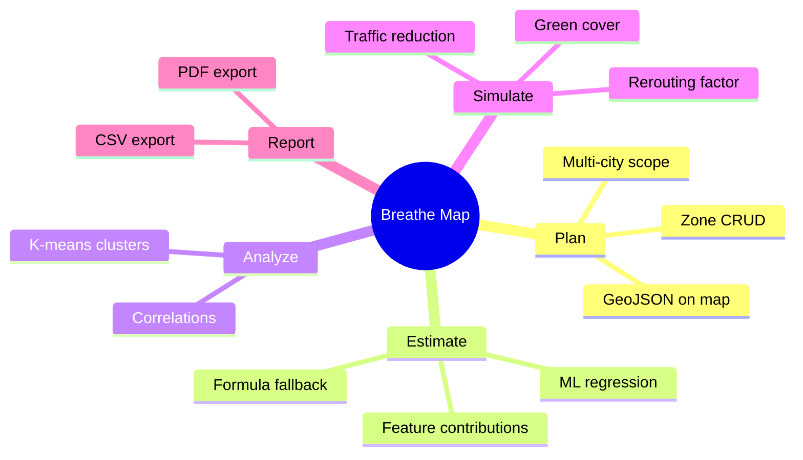

| Capability | Description | Primary UI |
|------------|-------------|------------|
| Hyperlocal AQI | Per-zone estimates from urban proxies + ML | Dashboard, Zones |
| Spatial view | Leaflet map, CARTO dark basemap, zone polygons | Dashboard |
| Pattern analysis | Correlation & clustering over zone features | Analysis |
| What-if simulation | Before/after AQI for mitigation levers | Simulation |
| Reporting | City summary exports for planning docs | Nav → Export |

### AQI category scale (India CPCB–aligned bands)

| Category | AQI range | Planning signal |
|----------|-----------|-----------------|
| Good | 0–50 | Low concern |
| Satisfactory | 51–100 | Acceptable; monitor growth |
| Moderate | 101–200 | Sensitive groups at risk |
| Poor | 201–300 | Health warnings; intervention priority |
| Severe | 301+ | Emergency planning tier |

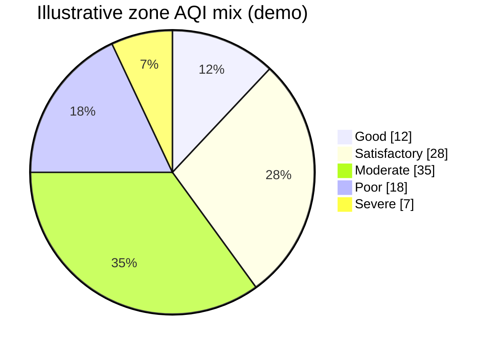

*Chart is illustrative; actual distribution depends on your city’s zones and estimates.*

---

## Problem & goals

Urban AQI is often published as a **single city average**, which hides block-level variation driven by traffic, land use, and density. Planners need tools to **estimate** hyperlocal conditions and **compare** mitigation options before capital spend.

**Goals**

- Estimate AQI at **zone / ward / grid** resolution within a city  
- Relate estimates to **interpretable urban factors** (traffic, population, roads, land use)  
- Run **scenario simulations** (e.g. vehicle reduction, green cover)  
- Present results on an **interactive map** and in **exportable reports**  
- Stay feasible for academic / hackathon use (no live sensor mesh required)

**Non-goals:** real-time IoT ingestion, causal source apportionment, enforcement, or citizen surveillance. See [PRD.md](./PRD.md) for full scope.

---

## System architecture

### Context (who talks to what)

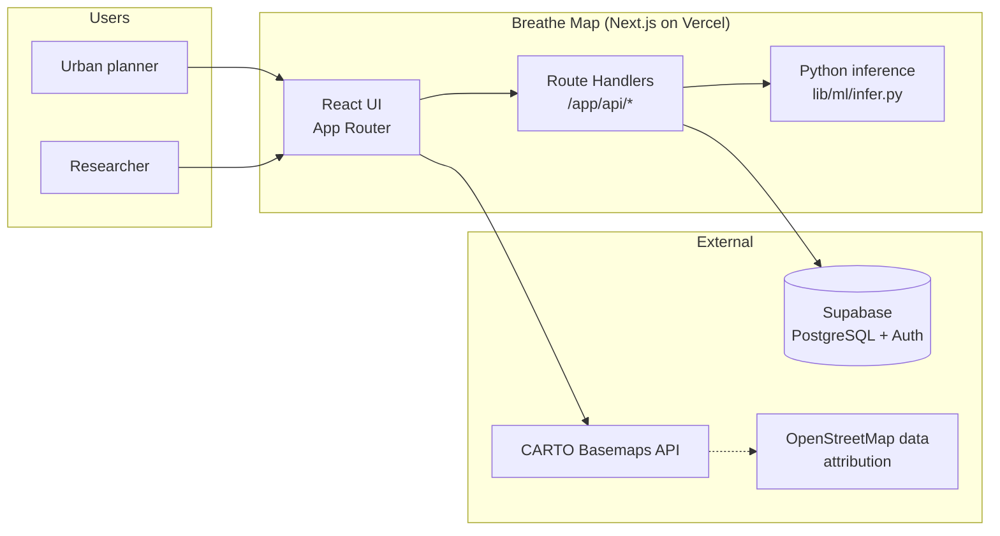

### Container view (inside the web app)

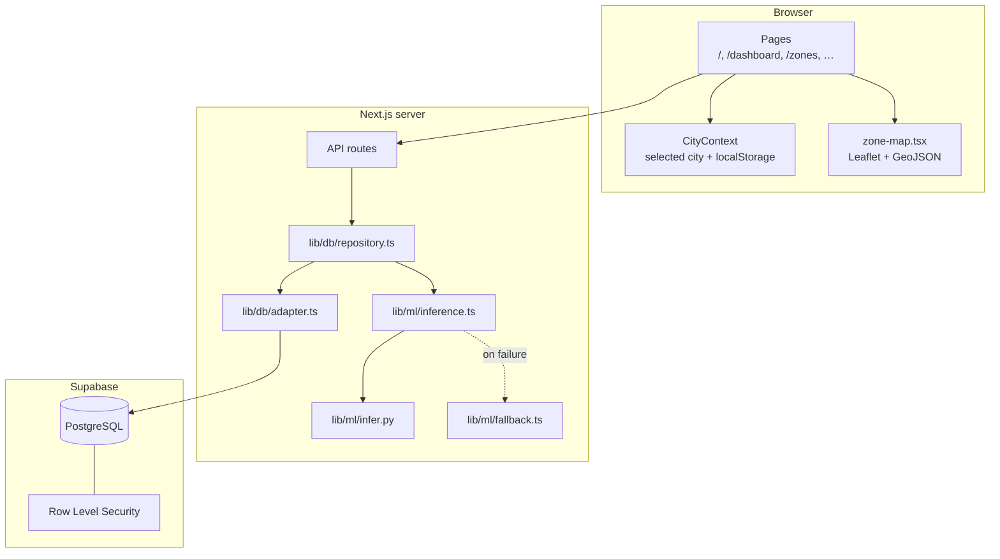

### Layer responsibilities

| Layer | Role |
|-------|------|
| **UI** | Dashboard, zone management, analysis charts, simulation forms, PDF/CSV export |
| **API** | Validation, aggregation, persistence, orchestration of ML inference |
| **Repository** | Domain operations: zones, AQI storage, correlations, simulations |
| **ML (offline train, online infer)** | scikit-learn models trained in Python; runtime inference via `python3 infer.py` |
| **Supabase** | Canonical storage, auth-ready schema, RLS for read/write policies |
| **Maps** | CARTO raster tiles (API key required in production since 2026) + client-side geometry |

---

## Data flow

### End-to-end: open dashboard for a city

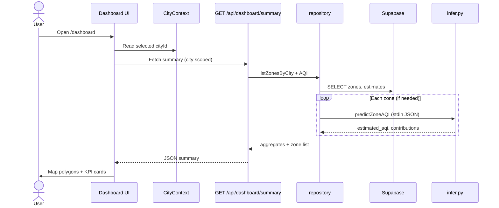

### Zone creation and estimate persistence

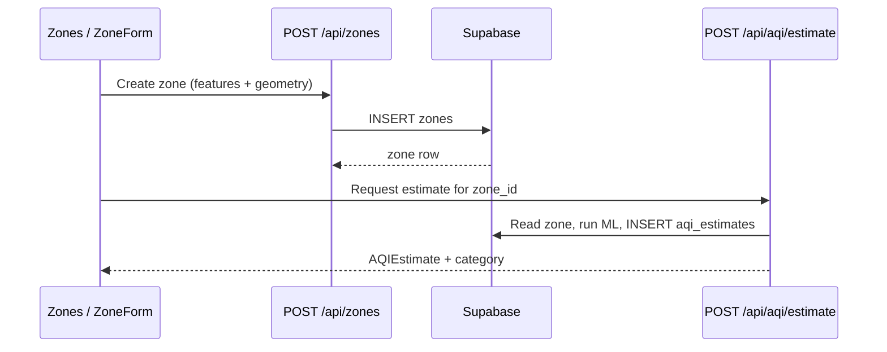

### Simulation run

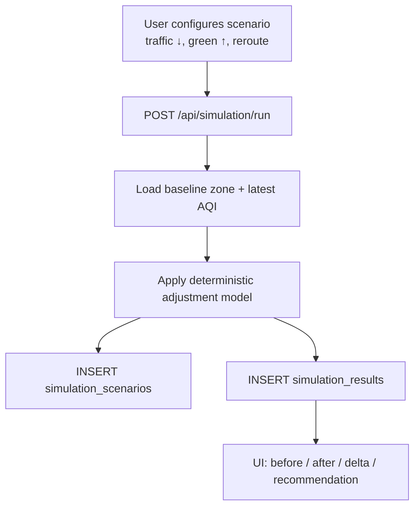

---

## User journeys

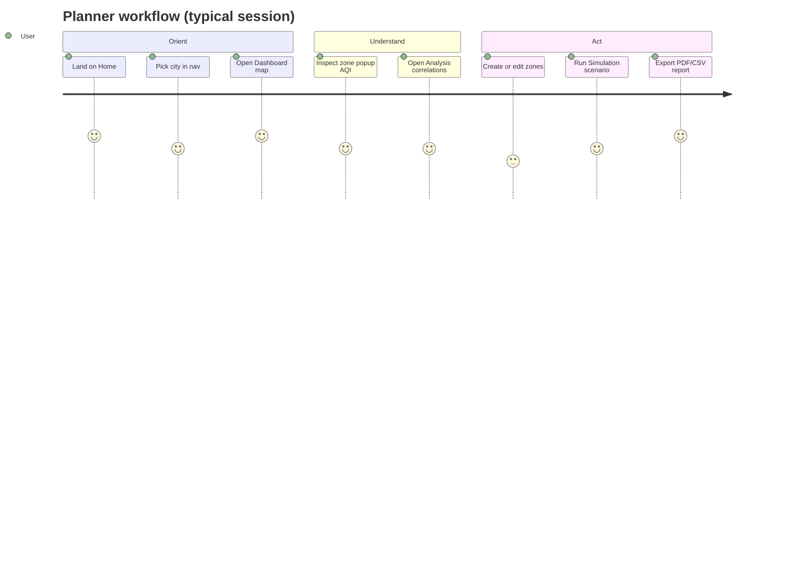

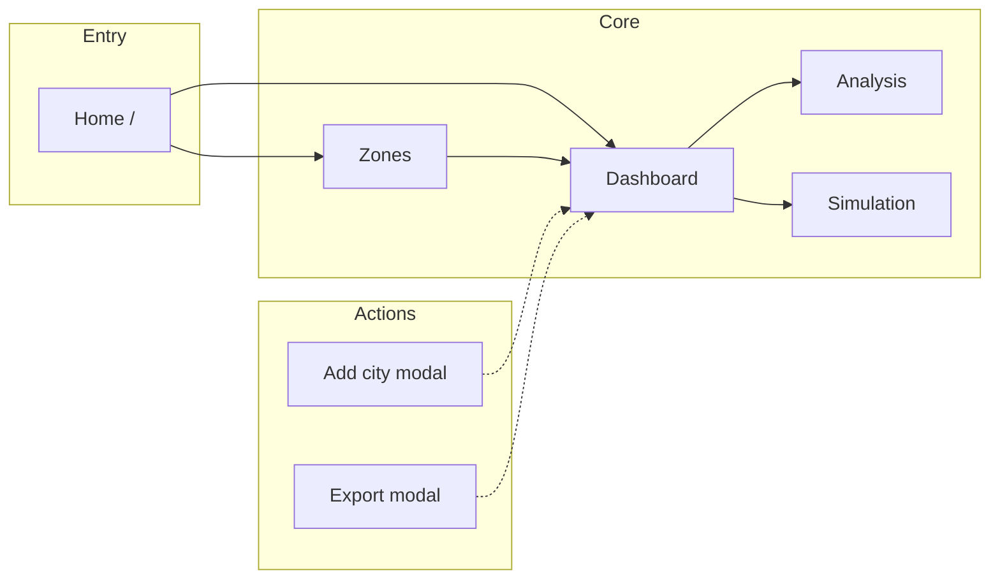

---

## Database model

Run migrations in order under `web/supabase/migrations/` (see [backend setup](./web/SUPABASE_BACKEND_SETUP.md)).

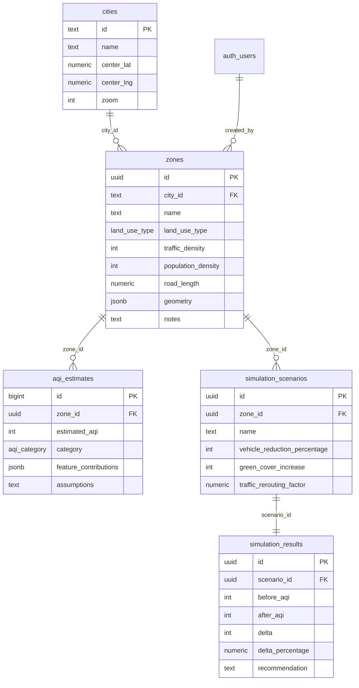

**Enums:** `land_use_type` (residential, commercial, industrial, green_space, mixed), `aqi_category` (good, satisfactory, moderate, poor, severe).

---

## Machine learning pipeline

ML is **supportive and interpretable** — the app remains usable via formula-based fallback if Python inference fails.

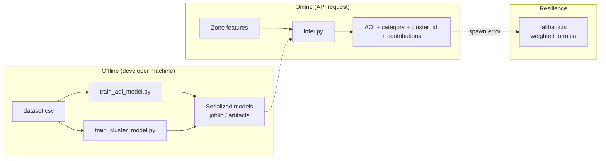

| Stage | Script / module | Output |
|-------|-----------------|--------|
| Train regression | `web/lib/ml/train_aqi_model.py` | AQI prediction model |
| Train clustering | `web/lib/ml/train_cluster_model.py` | Zone pollution archetypes |
| Runtime | `web/lib/ml/inference.ts` → `infer.py` | JSON estimate per zone |
| Fallback | `web/lib/ml/fallback.ts` | Deterministic estimate + contributions |

**Feature inputs (conceptual):** traffic density, population density, road length, land use type, derived ambient proxies (temperature, humidity, time-of-day).

---

## Application surface

| Route | Purpose |
|-------|---------|
| `/` | Landing and product overview |
| `/dashboard` | City KPIs, zone map, quick zone actions |
| `/zones` | Zone list with latest AQI |
| `/zones/new`, `/zones/[id]`, `/zones/[id]/edit` | Create and manage zones |
| `/analysis` | Correlation views and cluster insights |
| `/simulation` | Scenario builder and results |
| `/cities` | City management (where enabled) |

**Shared UI:** `CityContext` (persisted city selection), `NavBar` (city switcher, add city, export), `zone-map` (Leaflet), `ExportModal` (CSV/PDF).

---

## API reference

| Method | Path | Description |
|--------|------|-------------|
| `GET` | `/api/zones` | List zones (optional city filter) |
| `POST` | `/api/zones` | Create zone |
| `GET` | `/api/zones/[id]` | Zone detail + latest estimate |
| `PUT` / `DELETE` | `/api/zones/[id]` | Update / delete zone |
| `POST` | `/api/aqi/estimate` | Run estimate and store `aqi_estimates` |
| `GET` | `/api/dashboard/summary` | Dashboard aggregates for active city |
| `GET` | `/api/analysis/correlations` | Feature ↔ AQI correlation table |
| `GET` | `/api/analysis/clusters` | Cluster assignments / summaries |
| `POST` | `/api/simulation/run` | Persist scenario + results |
| `GET` | `/api/cities` | List cities |
| `GET` | `/api/reports/summary` | Data bundle for export modal |

Server routes use `SUPABASE_SERVICE_ROLE_KEY` for trusted writes; see RLS notes in [SUPABASE_BACKEND_SETUP.md](./web/SUPABASE_BACKEND_SETUP.md).

---

## Technology stack

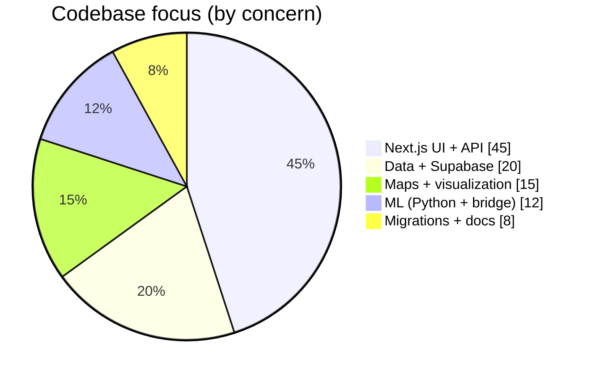

| Area | Choices |
|------|---------|
| Framework | Next.js (App Router), React, TypeScript |
| Styling | Tailwind CSS, Radix / shadcn-style components |
| Maps | Leaflet, GeoJSON zone geometry, CARTO basemaps |
| Data | Supabase (PostgreSQL, Auth, RLS) |
| ML | Python 3, pandas, scikit-learn; Node `spawnSync` bridge |
| Export | jsPDF, jspdf-autotable, client-side CSV |
| Hosting | Vercel (typical), Supabase cloud |

---

## Repository layout

```
breathe-map/
├── README.md                 ← you are here
├── PRD.md                    ← product requirements
├── LICENSE
└── web/                      ← Next.js application (monorepo root for app code)
    ├── app/                  ← pages + API route handlers
    ├── components/           ← UI, map, modals, forms
    ├── context/              ← CityContext
    ├── lib/
    │   ├── db/               ← adapter + repository
    │   ├── ml/               ← train scripts, infer.py, inference.ts, fallback
    │   ├── supabase/         ← server client + env helpers
    │   └── cartoBasemap.ts   ← CARTO tile URLs + API key
    ├── supabase/migrations/  ← SQL schema (run in order)
    ├── .env.example
    └── SUPABASE_BACKEND_SETUP.md
```

*Legacy docs may mention `/frontend` and `/ml` at repo root; the active app and ML code live under `web/`.*

---

## Local development

### Prerequisites

- Node.js 18+  
- npm  
- Python 3 with scikit-learn stack (for ML inference)  
- Supabase project (URL + keys)  
- [CARTO Basemaps API key](https://carto.com/basemaps/apikey) (required for map tiles in dev/production)

### Setup

```bash
cd web
cp .env.example .env.local
# Edit .env.local — Supabase + NEXT_PUBLIC_CARTO_BASEMAPS_API_KEY

npm install
npm run dev
```

Open [http://localhost:3000](http://localhost:3000).

### Database

Apply SQL migrations in Supabase SQL Editor **in filename order**:

1. `20260217_init_breathe_map.sql`  
2. `20260301_add_city_scope.sql`  
3. `20260302_cities_and_geometry.sql`  
4. `20260401_add_satisfactory_category.sql`  

Details: [web/SUPABASE_BACKEND_SETUP.md](./web/SUPABASE_BACKEND_SETUP.md).

### ML (optional refresh)

```bash
cd web/lib/ml
python3 train_aqi_model.py
python3 train_cluster_model.py
python3 test_models.py
```

---

## Deployment

Typical production layout:

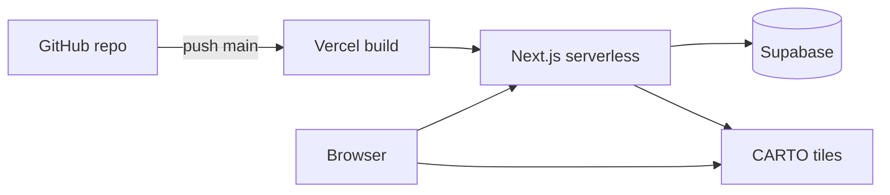

1. Connect the GitHub repository to Vercel with **root directory** `web` (if the project is not already configured that way).  
2. Set environment variables in Vercel (Production + Preview):

   | Variable | Required |
   |----------|----------|
   | `NEXT_PUBLIC_SUPABASE_URL` | Yes |
   | `NEXT_PUBLIC_SUPABASE_ANON_KEY` | Yes |
   | `SUPABASE_SERVICE_ROLE_KEY` | Yes (server only) |
   | `NEXT_PUBLIC_CARTO_BASEMAPS_API_KEY` | Yes (map tiles) |

3. Ensure Supabase migrations are applied on the linked project.  
4. Push to `main` — Vercel redeploys automatically.

**Fork workflow:** push to your fork → open PR to [a23droid/breathe-map](https://github.com/a23droid/breathe-map) → after merge, sync fork with `git fetch upstream && git merge upstream/main && git push origin main`.

---

## Scope, ethics & disclaimer

### In scope

- Planning, simulation, and exploratory analytics  
- Transparent estimates with documented assumptions  
- Multi-city, zone-level visualization  

### Out of scope

- Real-time sensor networks  
- Legal/regulatory AQI certification  
- Individual tracking or enforcement  

### Ethics

- Results are **model estimates**, not ground-truth measurements.  
- Correlations are **descriptive**, not causal claims.  
- Use outputs to **inform** dialogue and prioritization, not to penalize communities or individuals.

### Disclaimer

Breathe Map is for **academic, research, and urban planning simulation** only. Do not use it as a substitute for certified monitoring, emergency alerting, or regulatory compliance.

---

## Contributing

1. Fork the repository and create a feature branch.  
2. Keep changes focused; match existing TypeScript and SQL migration patterns.  
3. Update docs when adding env vars, API routes, or migrations.  
4. Open a pull request against `a23droid/breathe-map` with a short test plan.

For product behavior and acceptance criteria, see [PRD.md](./PRD.md).

---

<p align="center">
  <sub>Breathe Map — intelligent air for smart cities</sub>
</p>
